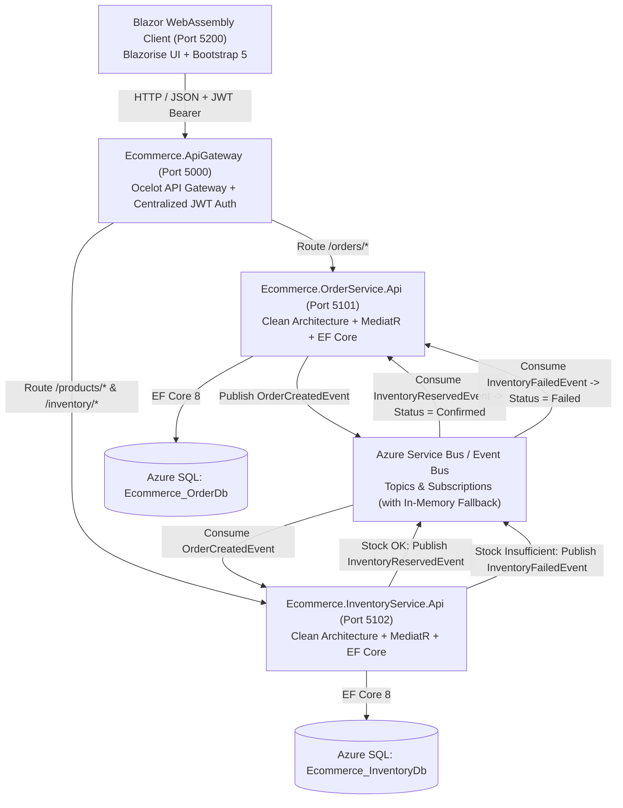

# Enterprise E-Commerce Microservices Platform

[](https://dotnet.microsoft.com/)
[](https://dotnet.microsoft.com/apps/aspnet/web-apps/blazor)
[](https://blazorise.com/)
[](https://ocelot.readthedocs.io/)
[](https://azure.microsoft.com/en-us/products/azure-sql/)
[](https://azure.microsoft.com/en-us/products/service-bus/)
[](#)

A Production-Ready, Event-Driven E-Commerce Microservices Application designed and implemented using **.NET 8**, **Clean Architecture**, **CQRS with MediatR**, **Ocelot API Gateway**, **Azure Service Bus**, **Azure SQL Database**, and a **Blazor WebAssembly** client built with **Blazorise (Bootstrap 5)**.

---

## 🏛️ System Architecture



---

## 📦 Project Structure

```
.
├── Ecommerce.sln                          # Master Visual Studio / .NET CLI Solution
├── docker-compose.yml                     # Multi-container local orchestration
│
├── scripts/
│   ├── run-services.ps1                   # One-click multi-process local launcher
│   ├── deploy-azure-databases.ps1         # Automated Azure SQL & DB provisioning via Azure CLI
│   ├── init-databases.sql                 # SQL Server master schema & seed script
│   ├── azure-order-db.sql                 # Azure SQL script for Ecommerce_OrderDb
│   └── azure-inventory-db.sql             # Azure SQL script for Ecommerce_InventoryDb
│
└── src/
    ├── Ecommerce.Shared/                  # Common Contracts, Integration Events & EventBus Abstractions
    │
    ├── Ecommerce.ApiGateway/              # YARP Reverse Proxy & Centralized JWT Authentication
    │
    ├── Ecommerce.OrderService/            # Order Microservice (Clean Architecture)
    │   ├── Ecommerce.OrderService.Domain/
    │   ├── Ecommerce.OrderService.Application/
    │   ├── Ecommerce.OrderService.Persistence/
    │   ├── Ecommerce.OrderService.Infrastructure/
    │   └── Ecommerce.OrderService.Api/
    │
    ├── Ecommerce.InventoryService/        # Product & Inventory Microservice (Clean Architecture)
    │   ├── Ecommerce.InventoryService.Domain/
    │   ├── Ecommerce.InventoryService.Application/
    │   ├── Ecommerce.InventoryService.Persistence/
    │   ├── Ecommerce.InventoryService.Infrastructure/
    │   └── Ecommerce.InventoryService.Api/
    │
    └── Ecommerce.WebApp/                  # Blazor WebAssembly (.NET 8) with Blazorise & Bootstrap 5
```

---

## ⚡ Technical Stack

### Backend
- **Framework**: .NET 8 Web API
- **Design Pattern**: Clean Architecture + CQRS + Repository Pattern
- **Mediator**: MediatR 12.x
- **Data Access**: Entity Framework Core 8
- **Databases**: Azure SQL Database / Microsoft SQL Server 2022
- **Validation**: FluentValidation
- **Mapping**: AutoMapper
- **Reverse Proxy**: Ocelot API Gateway (v23.3)
- **Security**: JWT Authentication (HMAC-SHA256) with Role-Based Access Control (RBAC)
- **Logging**: Serilog Structured Logging
- **API Documentation**: Swagger / OpenAPI with JWT Bearer support

### Messaging & Event-Driven Architecture
- **Message Broker**: Azure Service Bus (Topics & Subscriptions)
- **Local Fallback**: In-Memory async channel EventBus (zero-cloud setup for instant offline development)
- **Events**:
  - `OrderCreatedEvent`
  - `InventoryReservedEvent`
  - `InventoryFailedEvent`

### Frontend
- **Framework**: Blazor WebAssembly (.NET 8)
- **Component Suite**: Blazorise (v1.6+) with Bootstrap 5 Provider
- **Icons**: FontAwesome 6
- **State & Storage**: Blazored.LocalStorage + Custom `AuthenticationStateProvider`

---

## 🚀 Getting Started

### Prerequisites
- [.NET 8 SDK or higher](https://dotnet.microsoft.com/download/dotnet/8.0)
- SQL Server (or Azure SQL Database)
- PowerShell (Windows, macOS, or Linux)

---

### Method 1: Visual Studio 2022 Multi-Project Profile (.slnLaunch)
Open `Ecommerce.sln` in **Visual Studio 2022**.
In the startup project dropdown on the top toolbar, select:
> **`Run All (UI + Microservices)`**  
and press **F5** (or **Ctrl+F5** to run without debugging). Visual Studio will simultaneously launch the Blazor WebApp, API Gateway, Order Service, and Inventory Service.

---

### Method 2: VS Code / Cursor Compound Launch Profile
Open the root repository folder in **VS Code**.
Go to **Run & Debug (Ctrl+Shift+D)** and select:
> **`🚀 Run All (UI + All Backend Services)`**  
and press **F5**. All services will be built and launched together.

---

### Method 3: One-Click Script (Windows)
Double-click `start-all.bat` (or run in PowerShell):
```powershell
.\scripts\run-services.ps1
```
To stop all running microservices and background daemons at any time, double-click `stop-all.bat`.

Services will be accessible at:
- **Blazor WebApp**: [http://localhost:5200](http://localhost:5200)
- **API Gateway (Ocelot)**: [http://localhost:5000](http://localhost:5000)
- **Order Service Swagger**: [http://localhost:5101/swagger](http://localhost:5101/swagger)
- **Inventory Service Swagger**: [http://localhost:5102/swagger](http://localhost:5102/swagger)

---

### Method 4: Manual Startup

```bash
# Terminal 1: Order Service
cd src/Ecommerce.OrderService/Ecommerce.OrderService.Api
dotnet run --urls "http://localhost:5101"

# Terminal 2: Inventory Service
cd src/Ecommerce.InventoryService/Ecommerce.InventoryService.Api
dotnet run --urls "http://localhost:5102"

# Terminal 3: API Gateway
cd src/Ecommerce.ApiGateway
dotnet run --urls "http://localhost:5000"

# Terminal 4: Blazor WebAssembly WebApp
cd src/Ecommerce.WebApp
dotnet run --urls "http://localhost:5200"
```

---

## ☁️ Azure SQL Database Configuration

Update `appsettings.json` in `Ecommerce.OrderService.Api` and `Ecommerce.InventoryService.Api`:

```json
{
  "ConnectionStrings": {
    "DefaultConnection": "Server=tcp:<your-server>.database.windows.net,1433;Initial Catalog=<database-name>;User ID=<user>;Password=<password>;Encrypt=True;TrustServerCertificate=False;Connection Timeout=30;"
  },
  "Database": {
    "UseInMemory": false
  }
}
```

> [!NOTE]
> Setting `"UseInMemory": true` allows running the entire application completely offline with automatic in-memory databases and pre-seeded sample data.

---

## 🔐 Demo Credentials

| Role | Email | Password | Permissions |
| :--- | :--- | :--- | :--- |
| **Admin** | `admin@ecommerce.com` | `Admin123!` | Full Product Catalog CRUD, Inventory Adjustments, View All Orders, Update Order Status |
| **Customer** | `customer@ecommerce.com` | `Customer123!` | Browse Catalog, Add to Cart, Checkout, View Own Orders & Event Timeline |

---

## 📄 License
This project is licensed under the MIT License.

